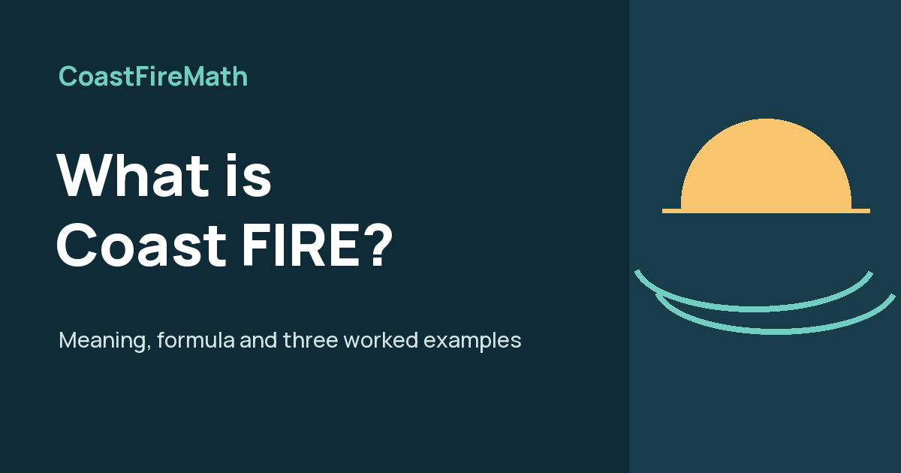

<div align="center">

<a href="https://coastfiremath.com/"></a>

# Coast FIRE Math

**Free, browser-only, inflation-adjusted calculators for Coast FIRE, FIRE Number, the 4% Rule, and Barista FIRE.**

[](https://coastfiremath.com/)
[](LICENSE)
[](https://workers.cloudflare.com/)
[](https://tanstack.com/start)
[](https://react.dev/)
[](https://www.typescriptlang.org/)

**English** · [中文](README.zh-CN.md)

</div>

---

**Coast FIRE Math** ([https://coastfiremath.com/](https://coastfiremath.com/)) is an independent, privacy-first retirement planning toolkit designed around one practical question: *when can retirement contributions become optional, letting compound growth carry your portfolio to your retirement target?*

All calculations run locally in your browser with no accounts, no paywalls, and no server-side storage of your financial numbers.

## Live Calculators & Guides

| Tool / Guide | Live Page | What It Does |
| --- | --- | --- |
| **Coast FIRE Calculator** | [coastfiremath.com](https://coastfiremath.com/) | Computes your Coast FIRE number, funding gap, estimated Coast age, target-age reverse monthly savings plan, return/inflation scenarios, and optional Excel (`.xlsx`) & Print/PDF exports. |
| **Coast FIRE by Age** | [/coast-fire-calculator-by-age/](https://coastfiremath.com/coast-fire-calculator-by-age/) | Interactive comparison table of Coast FIRE targets from age 22 to 60 across spending tiers and editable assumptions. |
| **FIRE Number Calculator** | [/fire-number-calculator/](https://coastfiremath.com/fire-number-calculator/) | Estimates full retirement targets across 3%, 3.5%, 4%, and custom withdrawal rates, with funding progress and an optional timeline. |
| **4% Rule Calculator** | [/4-percent-rule-calculator/](https://coastfiremath.com/4-percent-rule-calculator/) | Models retirement withdrawal rates, annual portfolio-funded spending, and required nest egg sizes. |
| **Barista FIRE Calculator** | [/barista-fire-calculator/](https://coastfiremath.com/barista-fire-calculator/) | Combines part-time income with portfolio withdrawals to estimate bridge-to-retirement targets. |
| **What Is Coast FIRE?** | [/what-is-coast-fire/](https://coastfiremath.com/what-is-coast-fire/) | Plain-English guide covering the Coast FIRE formula, worked examples, account types, and comparisons with other FIRE paths. |
| **Coast FIRE vs FIRE** | [/coast-fire-vs-fire/](https://coastfiremath.com/coast-fire-vs-fire/) | Side-by-side comparison of Coast FIRE and Full FIRE using the same target portfolio and assumptions. |
| **Methodology** | [/editorial-policy/](https://coastfiremath.com/editorial-policy/) | Transparent documentation of formulas, rounding conventions, assumptions, and official sources. |

## Modeling & Privacy Principles

- **Today's dollars & exact real return**: Converts nominal investment return and inflation using the exact real-return relationship `(1 + r) / (1 + i) - 1`, with effective monthly compounding.
- **Flexible contribution modes**: Supports both fixed nominal monthly contributions (default) and inflation-indexed monthly contributions.
- **Target-age reverse planner**: Pick a desired Coast age to back-solve the monthly savings needed, then apply it directly to the main model.
- **Client-side only**: Financial inputs live strictly in React memory — never uploaded, logged, placed in URLs, or persisted to browser storage.
- **Local exports on demand**: Generates an Excel (`.xlsx`) workbook or print/PDF summary locally only when you explicitly click export.

## Repository Layout

This repository is built on the open-source [ShipWords](https://github.com/shipwords-dev/shipwords) monorepo structure (`MIT`), with the Coast FIRE Math web app in [`sites/coast-fire/`](sites/coast-fire/):

| Directory | Description |
| --- | --- |
| `sites/coast-fire/` | **Coast FIRE Math application** — routes, calculator models (`src/lib/`), unit tests, UI components (`src/site/`), SEO/sitemap/robots helpers, and static assets |
| `packages/core/` | Shared SSR, SEO/metadata, and utility modules |
| `packages/jobs/` | Shared framework package from the starter monorepo |
| `templates/ai-site/` | Upstream starter template |
| `tools/` | Workspace and launch-check utilities (`check-public`, `list-sites`, etc.) |

See [`sites/coast-fire/README.md`](sites/coast-fire/README.md) for detailed site-level architecture, modeling assumptions, and deployment notes.

## Local Development

Requirements: **Node 24+** (see `.nvmrc`) and **pnpm 10** (`pnpm@10.30.1`). No API keys, database, or Cloudflare login are required to run locally.

```bash
# 1. Install dependencies
pnpm install

# 2. Start the Coast FIRE Math dev server (http://127.0.0.1:5030)
pnpm --filter @shipwords/site-coast-fire dev
```

### Testing & Verification

```bash
# Run calculator & route unit tests
pnpm --filter @shipwords/site-coast-fire test

# Run typecheck + unit tests + Cloudflare production build
pnpm --filter @shipwords/site-coast-fire check

# Preview the production build locally
pnpm --filter @shipwords/site-coast-fire preview

# Lint & check tracked files for private values
pnpm lint
pnpm check:public
```

### Production Configuration

Before deploying from `sites/coast-fire/` (`pnpm run deploy`), configure the public build-time environment variables documented in [`sites/coast-fire/.env.example`](sites/coast-fire/.env.example):

- `VITE_PUBLIC_SITE_URL` — Public HTTPS origin without a trailing slash (e.g. `https://coastfiremath.com`)
- `VITE_CONTACT_EMAIL` — Public contact address shown on the Contact page
- `VITE_OPERATOR_NAME` — Site operator name shown on the About page

Builds without valid production settings automatically output `noindex`, omit canonical URLs, and serve an empty sitemap.

## Links & Disclaimer

- **Live Website**: [https://coastfiremath.com/](https://coastfiremath.com/)
- **About**: [https://coastfiremath.com/about/](https://coastfiremath.com/about/)
- **Privacy Policy**: [https://coastfiremath.com/privacy/](https://coastfiremath.com/privacy/)
- **Contact**: [https://coastfiremath.com/contact/](https://coastfiremath.com/contact/)

> **Educational use only:** Coast FIRE Math provides smooth mathematical projections based on user-supplied assumptions. It is not personalized financial, investment, or tax advice.

## License

[MIT](LICENSE)
