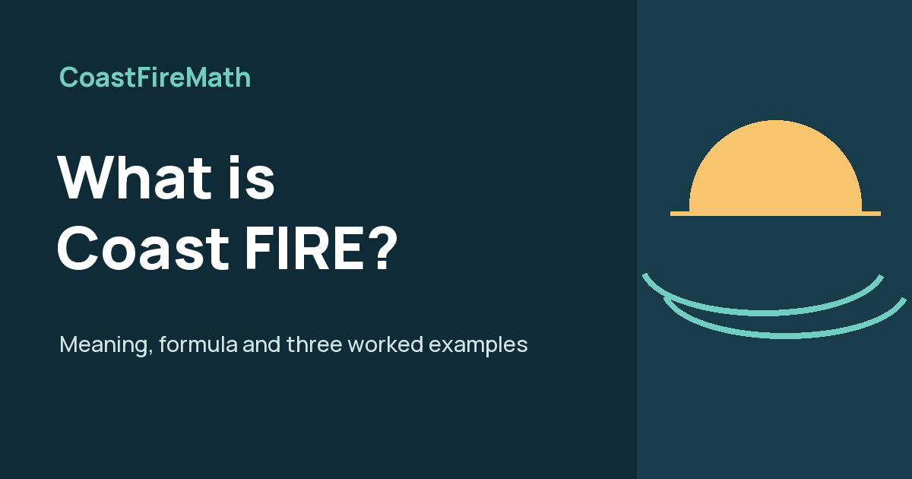

<div align="center">

<a href="https://coastfiremath.com/"></a>

# Coast FIRE Math

**免费、纯浏览器本地运行、经通胀调整的 Coast FIRE / FIRE Number / 4% 法则 / Barista FIRE 退休规划计算器套件。**

[](https://coastfiremath.com/)
[](LICENSE)
[](https://workers.cloudflare.com/)
[](https://tanstack.com/start)
[](https://react.dev/)
[](https://www.typescriptlang.org/)

[English](README.md) · **中文**

</div>

---

**Coast FIRE Math**（官网：[https://coastfiremath.com/](https://coastfiremath.com/)）是一个独立、注重隐私的退休规划计算工具站，聚焦一个核心问题：_需要攒够多少投资本金，之后就可以停止继续向退休账户追加储蓄，仅靠复利增长在目标退休年龄达成退休资产目标？_

所有计算均在浏览器本地完成，无需登录、无付费墙，也不会上传或保存用户的任何财务输入。

## 在线工具与指南

| 工具 / 页面                 | 在线地址                                                                                  | 功能说明                                                                                                                                  |
| --------------------------- | ----------------------------------------------------------------------------------------- | ----------------------------------------------------------------------------------------------------------------------------------------- |
| **Coast FIRE 计算器**       | [coastfiremath.com](https://coastfiremath.com/)                                           | 计算 Coast FIRE 目标金额、资金缺口、预计达成年龄、按目标年龄反推月储蓄额、收益率/通胀情景对比，以及本地 Excel (`.xlsx`) 与打印/PDF 导出。 |
| **按年龄查 Coast FIRE 表**  | [/coast-fire-calculator-by-age/](https://coastfiremath.com/coast-fire-calculator-by-age/) | 交互式对比 22–60 岁各年龄段与不同月支出档位的 Coast FIRE 目标金额。                                                                       |
| **FIRE Number 计算器**      | [/fire-number-calculator/](https://coastfiremath.com/fire-number-calculator/)             | 按 3%、3.5%、4% 及自定义提取率估算完整退休目标资产、达成进度与可选时间线。                                                                |
| **4% 法则计算器**           | [/4-percent-rule-calculator/](https://coastfiremath.com/4-percent-rule-calculator/)       | 测算 4% 法则及自定义提取率下的退休年度可提取金额与所需组合规模。                                                                          |
| **Barista FIRE 计算器**     | [/barista-fire-calculator/](https://coastfiremath.com/barista-fire-calculator/)           | 结合兼职收入与投资组合提取，估算半退休过渡期（Bridge-to-Retirement）的资产目标。                                                          |
| **什么是 Coast FIRE？**     | [/what-is-coast-fire/](https://coastfiremath.com/what-is-coast-fire/)                     | 系统讲解 Coast FIRE 概念、计算公式、完整算例、账户税务类型及与其他 FIRE 路线的区别。                                                      |
| **Coast FIRE vs FIRE 对比** | [/coast-fire-vs-fire/](https://coastfiremath.com/coast-fire-vs-fire/)                     | 在相同目标资产与假设下，并排对比 Coast FIRE 与 Full FIRE 的关键差异。                                                                     |
| **计算方法与编辑政策**      | [/editorial-policy/](https://coastfiremath.com/editorial-policy/)                         | 公开说明公式推导、假设口径、取整规则与官方参考来源。                                                                                      |

## 核心模型与隐私设计

- **今日购买力口径与精确实际收益率**：采用 `(1 + r) / (1 + i) - 1` 精确换算名义收益率与通胀率，并按月度有效复利进行逐月推演。
- **灵活的储蓄口径**：支持固定名义月供（默认）以及随通胀同步递增的实际购买力月供模式。
- **目标年龄反推规划器**：选定希望达成 Coast FIRE 的目标年龄，反推所需每月储蓄额，并一键应用到主计算器。
- **纯前端计算，零数据留存**：所有财务输入仅保存在当前页面的 React 内存中，不会上传服务器、不写入 URL、也不写入浏览器本地存储。
- **按需本地导出**：仅在用户主动点击时于浏览器本地生成 Excel (`.xlsx`) 表格或打印/PDF 摘要。

## 目录结构

本仓库基于开源的 [ShipWords](https://github.com/shipwords-dev/shipwords) Monorepo 结构（`MIT`），Coast FIRE Math 的核心代码位于 [`sites/coast-fire/`](sites/coast-fire/)：

| 目录                 | 说明                                                                                                                           |
| -------------------- | ------------------------------------------------------------------------------------------------------------------------------ |
| `sites/coast-fire/`  | **Coast FIRE Math 主应用** — 页面路由、计算引擎（`src/lib/`）、单元测试、UI 组件（`src/site/`）、SEO/Sitemap/Robots 与静态资源 |
| `packages/core/`     | 共享的 SSR、SEO/元数据与工具模块                                                                                               |
| `packages/jobs/`     | Monorepo 模板自带的共享包                                                                                                      |
| `templates/ai-site/` | 上游脚手架模板                                                                                                                 |
| `tools/`             | 工作区与公开仓库安全检查脚本（`check-public`、`list-sites` 等）                                                                |

更多站点架构、假设细节与部署说明请参阅 [`sites/coast-fire/README.md`](sites/coast-fire/README.md)。

## 本地开发与测试

环境要求：**Node 24+**（见 `.nvmrc`）与 **pnpm 10**（`pnpm@10.30.1`）。本地运行无需任何 API 密钥、数据库或 Cloudflare 登录。

```bash
# 1. 安装依赖
pnpm install

# 2. 启动 Coast FIRE Math 本地开发服务器（http://127.0.0.1:5030）
pnpm --filter @shipwords/site-coast-fire dev
```

### 常用校验命令

```bash
# 运行计算器与路由单元测试
pnpm --filter @shipwords/site-coast-fire test

# 运行类型检查 + 单元测试 + Cloudflare 生产构建
pnpm --filter @shipwords/site-coast-fire check

# 本地预览生产构建结果
pnpm --filter @shipwords/site-coast-fire preview

# 代码检查与公开仓库隐私字段扫描
pnpm lint
pnpm check:public
```

### 生产环境构建变量

在 `sites/coast-fire/` 执行生产部署（`pnpm run deploy`）前，需配置 [`sites/coast-fire/.env.example`](sites/coast-fire/.env.example) 中的三个公开构建变量：

- `VITE_PUBLIC_SITE_URL` — 公开 HTTPS 站点根地址（不带末尾斜杠，例如 `https://coastfiremath.com`）
- `VITE_CONTACT_EMAIL` — 联系页面展示的公开联系邮箱
- `VITE_OPERATOR_NAME` — 关于页面展示的维护者名称

未完整配置上述变量时，构建产物会自动输出 `noindex`、省略 canonical 链接并返回空 sitemap。

## 相关链接与免责声明

- **官方网站**：[https://coastfiremath.com/](https://coastfiremath.com/)
- **关于项目**：[https://coastfiremath.com/about/](https://coastfiremath.com/about/)
- **隐私政策**：[https://coastfiremath.com/privacy/](https://coastfiremath.com/privacy/)
- **联系我们**：[https://coastfiremath.com/contact/](https://coastfiremath.com/contact/)

> **仅作教育与测算参考**：Coast FIRE Math 基于用户输入假设提供平滑数学推演，不构成个性化财务、投资或税务建议。

## 开源协议

[MIT](LICENSE)
